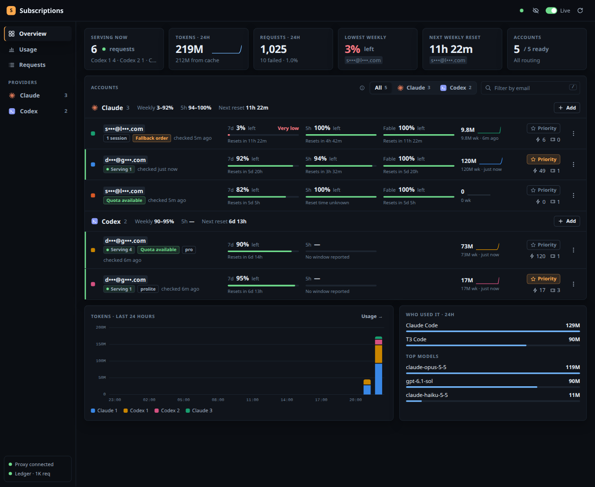
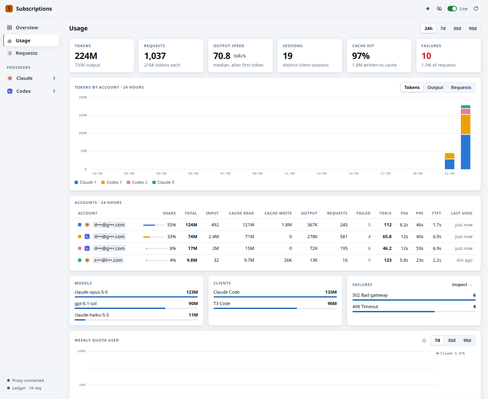

# cliproxy-console

A private web console for a [CLIProxyAPI](https://github.com/router-for-me/CLIProxyAPI) proxy
that pools several Claude and ChatGPT (Codex) subscriptions behind one endpoint, so Claude
Code, Codex and other clients can keep working when one account runs low.

What it shows and does:

- **Quota per account**: weekly, 5-hour and model-scoped (e.g. Fable) windows from the
  providers, reset countdowns, low/very-low warnings, reset tickets, Codex credit balance.
- **Which account is serving right now**: requests in flight per account and sticky sessions,
  read from the proxy's own routing log.
- **Token usage per account**: a local ledger of every request (input, cache read/write,
  output, reasoning), with 24h / 7d / 30d / 90d history, models, clients, failures,
  latency, time to first token and output speed (tok/s).
- **API estimate**: what the same tokens would cost at public pay-as-you-go list prices,
  per account, model, client, request and hour/day, split by token type, with cache
  savings. Prices come from LiteLLM's public table (the source T3 Code's usage page uses);
  long-context tiers are applied per request. The accounts are subscriptions, so it is an
  estimate, not a bill.
- **Phone layout**: bottom tab bar, stacked rows instead of wide tables, tap for chart and
  figure details.
- **Quota history**: weekly usage per account over time.
- **Account actions**: add (OAuth sign-in), remove, set a priority account, check usage
  now, use a reset ticket (hold to confirm, re-checked with the provider first).
- **Codex fast mode**: one switch on the Codex group asks for priority processing on every
  Codex request through the proxy, from every client. It is a single payload override rule
  in the proxy config (`requests.payload.override`, `service_tier: priority` for the
  `codex` protocol), saved through the proxy's config API, which reloads it without a
  restart; other payload rules are left as they are.
- **Privacy mode**: emails masked by default, click one to peek; charts use aliases like
  "Claude 2". Safe to screenshot.

It is one Python gateway (standard library only) plus a single HTML file. No build step,
no npm, no database server.





Both screenshots have privacy mode on: emails are masked and charts use aliases.

## Install with an AI agent

Paste this into Claude Code, Codex or another agent that can run commands on the machine
you want to set up:

```text
Install cliproxy-console on this machine. Clone https://github.com/monthly-party/cliproxy-console
(use my gh login if it asks for credentials), then follow INSTALL.agent.md in that repo from
start to finish. Ask me before installing packages, using sudo, overwriting files, or changing
existing Tailscale Serve settings. Never show me or write out any key or token. Finish when
scripts/doctor.py reports 0 failed, then tell me how to open the console and add my accounts.
```

[`INSTALL.agent.md`](INSTALL.agent.md) walks the agent through every step: checking the
machine, choosing settings with you, keys, building or downloading the proxy, services,
Tailscale Serve, client wrappers and a final check. You only sign in to your accounts
yourself, in the console.

## How it fits together

```
clients (Claude Code, Codex, …) ──► proxy :8317 (CLIProxyAPI v8, optional weekly-reset overlay)
                                         │ usage queue, routing log, management API
Tailscale Serve (https) ──► gateway :8318 (gateway/)
                                         ├─ dashboard.html
                                         ├─ usage_ledger.py  → $CONSOLE_DIR/usage.db (SQLite)
                                         ├─ pricing.py       → $CONSOLE_DIR/model-rates.json (daily, from LiteLLM)
                                         ├─ quota_poller.py  → quota snapshot + cache (10-minute polling)
                                         ├─ live_activity.py ← $PROXY_LOG
                                         └─ reset_tickets.py → provider APIs through the proxy
```

The browser only talks to the gateway. The gateway accepts requests from one Tailscale login
(the `Tailscale-User-Login` header that Tailscale Serve adds), allows a short list of
management routes, and never sends a token or the management key to the page.

| Path | What it is |
| --- | --- |
| `gateway/management_gateway_owner.py` | HTTP server, route allowlist, quota overview, dashboard API, reset-ticket route |
| `gateway/owner_auth_policy.py` | Tailscale owner and same-origin checks |
| `gateway/account_preferences.py` | Priority account changes, with rollback |
| `gateway/quota_poller.py`, `quota_priority.py` | Shared provider quota polling; next-account-by-quota projection |
| `gateway/usage_ledger.py` | Drains the proxy usage queue into SQLite; usage, requests and quota-history queries |
| `gateway/pricing.py` | List prices from LiteLLM (daily refresh, private on-disk copy) and the cost formula |
| `gateway/live_activity.py` | Tails the proxy log for in-flight requests and sticky sessions |
| `gateway/reset_tickets.py` | Spends one Claude or Codex reset ticket after a fresh provider check |
| `gateway/dashboard.html` | The page |
| `proxy/` | Build script, a loopback patch for the Claude OAuth callback, and the weekly-reset routing overlay |
| `bin/` | `claude-proxy` / `codex-proxy` client wrappers, sign-in helpers, readiness probe |
| `deploy/` | systemd and launchd templates, and an example proxy config |
| `scripts/deploy.py` | Installs the gateway into `$CONSOLE_DIR` safely (systemd or launchd) |
| `scripts/make-proxy-config.py` | Writes the proxy config from the example and your key files |
| `scripts/doctor.py` | Read-only checks of the machine and the install |
| `INSTALL.agent.md` | Step-by-step install guide written for an AI agent |

## Requirements

- Linux with systemd user services (WSL2 with systemd works), or macOS (launchd). Python 3.9+ (macOS's built-in python3 is fine).
- [Tailscale](https://tailscale.com) with HTTPS enabled, for `tailscale serve`.
- CLIProxyAPI v8. Build it with `proxy/build.py` (needs Go; see `proxy/upstream.json`) to
  get the weekly-reset routing and the loopback patch, or use a stock release with another
  routing strategy.
- One or more Claude Pro/Max and/or ChatGPT Plus/Pro accounts.

## Manual setup

The same steps the agent guide follows, in short. `scripts/doctor.py --stage pre` checks
the machine first; `scripts/doctor.py` checks the whole install at any time.

1. **Settings.** `mkdir -p ~/.config/cliproxy-console && cp config.env.example ~/.config/cliproxy-console/config.env`,
   then edit it: install directory, ports, your Tailscale https origin and login, unit names.
   Every other step reads this file.
2. **Proxy binary.** `proxy/build.py --out "$PROXY_BINARY"` (or download a release).
3. **Keys and proxy config.** Generate two keys into files with
   `umask 077; openssl rand -hex 32 > "$MANAGEMENT_KEY_FILE"` (and the same for
   `$CLIENT_KEY_FILE`), then run `scripts/make-proxy-config.py` (add `--stock` for a stock
   binary). It writes `$PROXY_CONFIG` from `deploy/config.example.yaml` without printing the
   keys; the proxy hashes the management key on first start.
4. **Proxy service.** `scripts/deploy.py --print-proxy-unit` prints a systemd unit (Linux) or
   launchd plist (macOS) for your settings. Review it, install it into
   `~/.config/systemd/user/$PROXY_UNIT` or `~/Library/LaunchAgents/$PROXY_UNIT.plist`, and
   start it.
5. **Console.** `scripts/deploy.py --units` (Linux: then `systemctl --user enable $CONSOLE_UNIT`).
6. **Expose it to yourself.** `tailscale serve --bg --https=8444 http://127.0.0.1:$CONSOLE_PORT`.
   Open `$CONSOLE_ORIGIN`.
7. **Add accounts** with the console's Add buttons, or `bin/sign-in-claude` / `bin/sign-in-codex`.
8. **Point clients at the proxy.** Put `bin/claude-proxy` and `bin/codex-proxy` on your PATH
   (symlinks are fine) and use them instead of `claude` and `codex`.

## Develop

```sh
make test          # unit tests (stdlib unittest)
make deploy-check  # what a deploy would change
make deploy        # install the committed tree into $CONSOLE_DIR
```

`scripts/deploy.py` refuses uncommitted changes and live files edited outside git, runs the
tests, backs up what it replaces into `$BACKUP_DIR`, restarts only the console (and only when
Python or its unit changed), health-checks the page and API, and rolls back if a check fails
or any unit in `PROTECTED_UNITS` changed PID. It never installs or restarts the proxy.

## Things worth knowing

- The console must be the **only** reader of the proxy's usage queue
  (`/v8/management/observability/usage/queue`); reading it removes the records. With
  `redis-usage-queue-retention-seconds: 3600` the proxy holds an hour of records, so console
  restarts lose nothing.
- The proxy watches its config file by inode. Editors that replace the file atomically won't
  trigger a reload; use `PATCH /v8/management/config`, which re-reads the file.
- Usage history starts when you enable usage statistics; the proxy keeps no earlier data.
  The ledger keeps 400 days of per-request counters, model, client and latency. It stores no
  API keys, IP addresses, headers or error bodies; session ids are hashed.
- Using a reset ticket and changing the priority account are real account actions. So is
  fast mode: priority processing uses more of each Codex account's quota. The ledger keeps
  the tier upstream served (`response_service_tier`), because the client's own request
  still says `auto` when the proxy adds priority, and the API estimate prices it at the
  model's priority rates.
- The API estimate is computed when you read it, so a newer price table re-prices all of
  history. The gateway fetches
  `raw.githubusercontent.com/BerriAI/litellm/main/model_prices_and_context_window.json` at
  most once a day (no credentials, no usage data sent) and keeps the last good copy if a
  fetch fails. Models without a list price are counted but not priced, and the page says so.
  Cache writes use the 5-minute rate because the proxy does not report the cache TTL.
- Any UI that shows an account email must go through `emailHTML()` or `aliasOf()` in
  `dashboard.html` so privacy mode covers it.
- Provider, model and client marks are the makers' own, copied from svgl.app (T3 Code's
  from its repository). They are trademarks of their owners.

## License

The proxy overlay and patch modify CLIProxyAPI source, which is MIT licensed; see
`proxy/LICENSE.upstream`.
